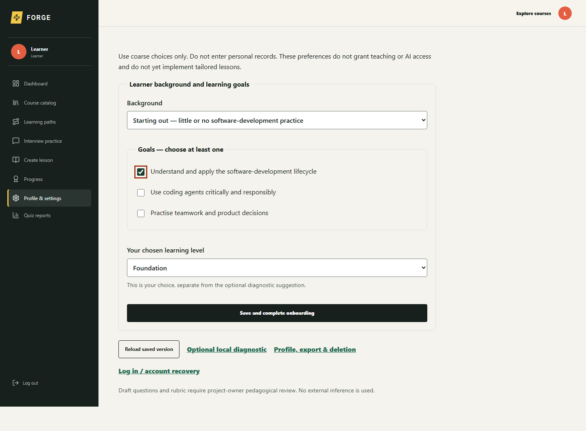
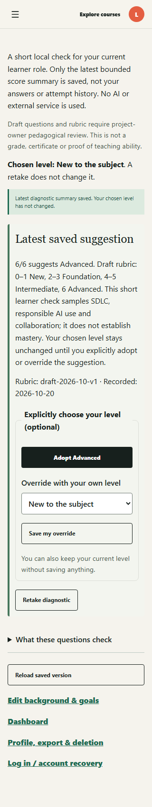
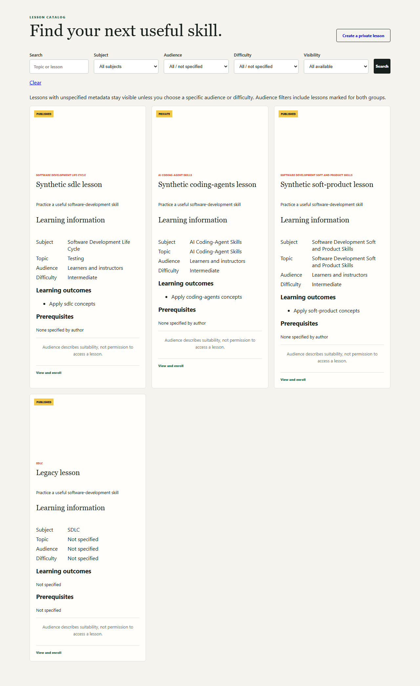
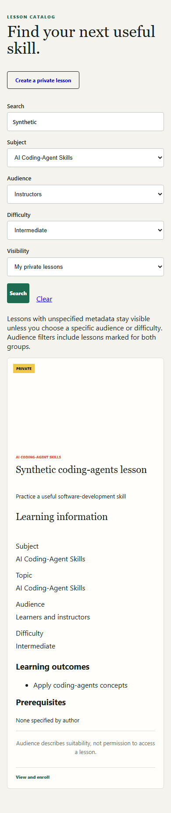
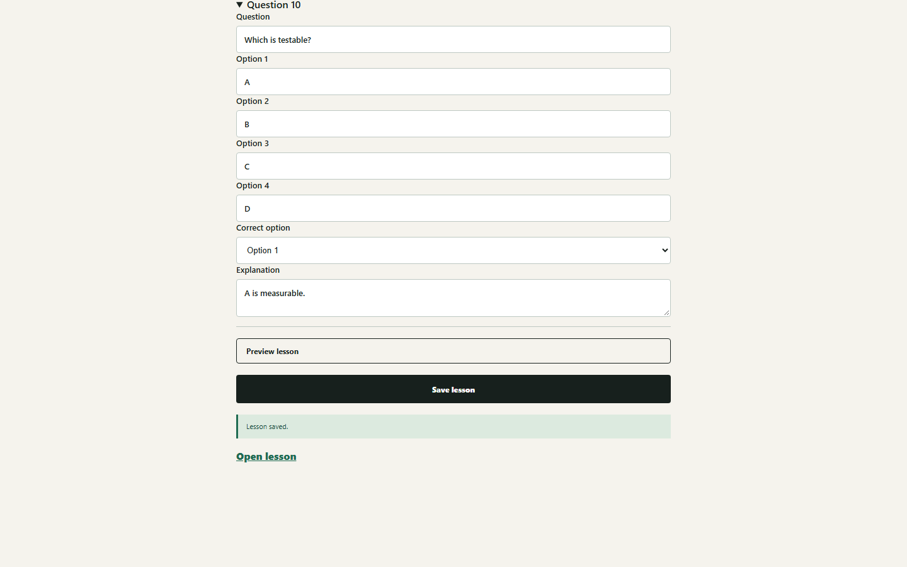
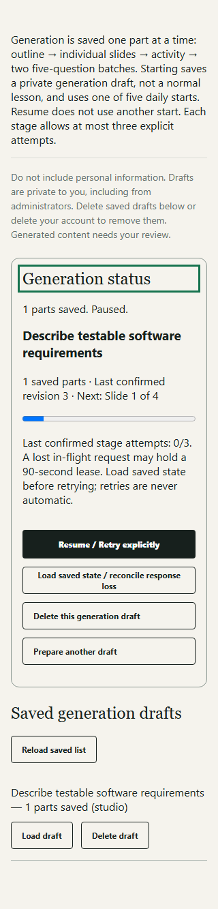
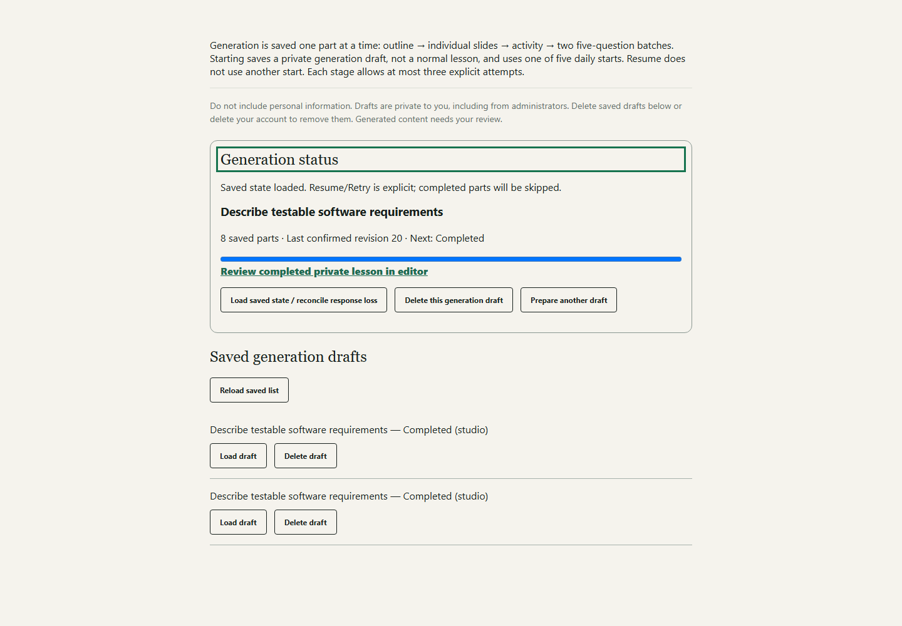

# Forge Learning Studio

## Small lessons. Visible practice. Reviewable AI assistance.

Forge Learning Studio is a software-development learning prototype that connects
short, structured lessons with practice, server-graded quizzes and instructor oversight.
Learners can study without external AI; eligible adults can optionally use AI-assisted
authoring, coaching, learning-path suggestions and text interview practice.

**COMP5241 project showcase · Snapshot: 20 October 2026 · Planned delivery: 31 October 2026**

> **Status:** implemented local prototype with bounded offline evidence, not a certified
> production release. The intended setting is a supervised Hong Kong demonstration,
> ages 13+. External AI requires a recorded adult age (18+) **and** a trusted
> administrator's explicit AI-access grant.

**Explore:** [Features](#features-by-role) · [Learner journey](#a-learner-journey) ·
[Gallery](#prototype-screenshot-gallery) · [Architecture](#architecture-at-a-glance) ·
[Delivery status](#implemented-locally-versus-still-open)

## The problem and intended users

Software-development study involves more than reading slides: learners need to connect
concepts to decisions, check their understanding and know what to practise next.
Instructors need manageable authoring, enrollment and reporting workflows without
automatically exposing private drafts or treating generated text as reviewed teaching material.

Forge brings these activities into a compact, role-aware workflow:

- **University learners and beginners:** discover relevant standalone lessons, practise,
  retry assessments and keep evidence of passing.
- **Instructors:** author and maintain their own lessons, publish them, enroll learners
  and inspect reports within their ownership boundary.
- **Administrators and approved reviewers:** manage trusted grants and bounded review access.
- **Participants aged 13–17:** use non-AI learning workflows; signup does not grant AI access.

## Features by role

All capabilities below describe the **local implementation**, subject to the open gates later.

| Role | Available prototype workflows | Important boundary |
| --- | --- | --- |
| Learner | Role-appropriate onboarding, optional six-question local diagnostic, chosen learning level | The diagnostic suggests a level; adoption or override is explicit. Self-report grants no instructor or AI rights. |
| Learner | Search/filter the catalog, enroll, bookmark, study slides and complete an ordering activity | Audience and difficulty describe suitability, not permission to access private content. |
| Learner | Submit quizzes, inspect saved feedback, retry and print passing-attempt certificates | Grading is server-side; attendance is distinct from passing. |
| Lesson owner | Manually create and edit private lessons, preview content and request review | Private drafts are not readable by administrators merely because they are administrators; the owner must submit a lesson for review. |
| AI-eligible adult | Save/resume staged lesson generation; optionally request coaching, AI paths or text interviews | External inference requires adult age, an administrator grant, applicable consent and available free-provider capacity. |
| Instructor | Publish/manage instructor-owned lessons, email-filter verified learner enrollment and view owned reports | Enrollment does not create accounts or send invitation emails; instructors do not gain access to others' private drafts. |
| Administrator / reviewer | Grant instructor status, AI access and quiz-report reviewer access; review submitted lessons | Reviewer grants concern reports, not learner assignment or unrestricted private-draft access. |
| Account owner | Maintain profile, export owned data and delete the account; delete individual interviews | Provider/hosting logs and backups need separate retention arrangements. |

## A learner journey

1. **Set a starting point.** Complete role-appropriate background/goals onboarding.
   Choose a level, optionally take the local diagnostic, then keep, adopt or override its suggestion.
2. **Find a useful skill.** Filter the catalog by subject family, audience, difficulty
   and visibility. Read the learning outcomes and prerequisites before enrolling.
3. **Study one focused mini-course.** Each mini-course is **one standalone lesson**:
   **4–6 slides**, followed by an ordering activity with **3–6 steps**.
4. **Check understanding.** Submit **exactly 10 questions**, each with **four options**.
   The server marks the attempt; **6/10 passes**. Quiz retries are unlimited.
5. **Keep evidence and continue.** Review saved attempt feedback and print an
   **HTML certificate for each passing attempt**. Attendance alone is not a pass.
6. **Optionally practise further.** Use local recommendations, or—only when eligible—
   optional AI paths, lesson coaching or private text interview practice.

The diagnostic is a separate, local orientation aid, not the ten-question lesson quiz,
a credential or proof of mastery. Only its latest bounded summary is retained, not
diagnostic answers or attempt history. Neither it nor path recommendations currently
implements genuinely tailored lesson explanations or practice.

## What distinguishes the design

These are project-specific design choices, not claims of worldwide novelty or proven learning gains.

1. **A deliberately small learning unit.** A consistent slide → activity → quiz contract
   makes a lesson straightforward to author, inspect and demonstrate. There are no
   multi-lesson course containers or community features in this prototype.
2. **Non-AI learning remains a first-class route.** Manual authoring and ordinary lesson,
   activity, quiz and certificate workflows do not depend on an external AI response.
   This matters for minors, unavailable providers and constrained demo budgets.
3. **Suggestion is not authority.** A diagnostic result does not silently change the
   learner's level; audience tags do not grant access; AI feedback is not a course grade.
4. **Recoverable generation rather than one opaque wait.** Generation saves an outline,
   individual slides, an activity and two five-question batches separately. Users explicitly
   pause, resume, retry or reconcile uncertain responses instead of silently starting a new copy.
5. **Private authoring before publication.** Whole-content validation and atomic
   finalization produce one canonical **private** lesson. Owner review, editing and
   permission-gated publication remain separate from generation.
6. **Ownership extends beyond the happy path.** Private interview history supports
   reopening, deletion and export; generic lesson-coach exchanges remain session-only.
   These are application design boundaries, not a security or privacy certification.

**Generation detail:** saving a generation draft makes no AI call. Pause/close stops
subsequent scheduling, not an already-running request, whose part may still save.
Reloading does not start inference; uncertain acknowledgements require loading saved
state and explicit reconciliation. The current local acceptance does not prove live provider quality.

## Curriculum families

| Family | Intended learning emphasis | Current content boundary |
| --- | --- | --- |
| **Software Development Life Cycle (SDLC)** | Overview/planning, requirements, design, implementation, testing, deployment and maintenance | Topic registry and explicit lesson metadata are local; reviewed demonstration lessons/resources remain open. |
| **AI Coding-Agent Skills** | Framing tasks, reviewing proposed changes and verifying outputs | A supported family, not evidence that every topic has a reviewed lesson or that embedded execution exists. |
| **Software Development Soft and Product Skills** | Collaboration, communication and product trade-offs | A supported family; pedagogical review and a curated resource collection are still required. |

Lessons carry explicit audience, difficulty, outcomes and prerequisites. Legacy lessons
without these fields remain identifiable as **not specified**, rather than being
silently classified as beginner-friendly. Optional local recommendations and AI paths
help select/order existing lessons; they are not genuine content adaptation.

## Prototype screenshot gallery

**Evidence type:** locally rendered routes/components with synthetic accounts and content,
captured by offline Chromium harnesses on 20 October 2026. These are actual prototype
renders, **not mockups, live deployed end-to-end screenshots or live AI results**.
Shell, navigation, image and action adapters may be substituted; blank catalog media
areas reflect the image adapter. Captures were inspected and copied unchanged into
`docs/screenshots/` so the gallery does not depend on temporary evidence directories.

### 1. A clear starting point — desktop onboarding



*The learner selects coarse background/goals and a level. The screen explicitly separates
these choices from diagnostic suggestions and warns that they do not grant teaching or AI access.*

### 2. Suggestions without automatic adoption — mobile diagnostic



*A synthetic 6/6 result suggests Advanced, but the chosen level remains unchanged.
The narrow layout retains explicit adopt, override and retake controls.*

### 3. Three subject families in one catalog — desktop



*The catalog exposes learning metadata alongside private/published labels.
The legacy card demonstrates honest handling of missing metadata; the lessons shown are fixtures.*

### 4. Focused discovery on a small screen — mobile catalog



*Stacked filters narrow discovery without confusing audience suitability with access.
The synthetic private lesson is shown in its owner's harness context.*

### 5. A complete non-AI authoring route — desktop editor



*This retained editor viewport shows a synthetic manual lesson's saved confirmation.
It illustrates authoring and feedback, not a learner's completed quiz or an externally generated lesson.*

### 6. Pause with saved progress — mobile generation



*The outline is saved and the next stage is slide 1 of 4. Resume and response-loss
reconciliation remain explicit, with no claim that closing the page cancels an in-flight request.*

### 7. Completion leads to private review — desktop generation



*The synthetic four-slide example has eight saved parts: outline, four slides, activity
and two question batches. Completion offers private editor review, not automatic publication.*

### Screenshot provenance and portability

All seven PNGs total **442,098 bytes** (about 432 KiB); no resizing, compositing or
invented UI was used. The three selected earlier-evidence images matched their recorded
SHA-256 inventory entries; all seven persistent copies matched their source-file hashes.

Evidence roots below are beneath the capturing machine's `%TEMP%`, not runtime dependencies:

- **E:** `forge-independent-lesson-20261020-qa/evidence/screenshots/` (retained inventory evidence).
- **C:** `forge-tracker08-DmwS9h/` (latest independent offline curriculum-route captures).
- **G:** `forge-generation-20261020-j2SRxG/` (latest independent saved-generation captures).

| Persistent filename | Pixels | Original evidence under the indicated root |
| --- | --- | --- |
| `onboarding-desktop.png` | 1440 × 1060 | E: `forge-onboarding-ui-0Lb7fV/onboarding-desktop.png` |
| `diagnostic-mobile.png` | 320 × 1685 | E: `forge-onboarding-ui-0Lb7fV/learner-diagnostic-320.png` |
| `catalog-desktop.png` | 1280 × 2088 | C: `catalog-desktop.png` |
| `catalog-mobile.png` | 390 × 1848 | C: `catalog-mobile-filtered.png` |
| `manual-authoring-desktop.png` | 1440 × 900 | E: `forge-manual-qa01-oowtqs/blank-saved-1440.png` |
| `generation-paused-mobile.png` | 320 × 1333 | G: `paused-320.png` |
| `generation-completed-desktop.png` | 1440 × 1000 | G: `completed-1440.png` |

Traceable harnesses: [onboarding](tests/onboarding-ui.test.mjs),
[curriculum routes](tests/curriculum-ui.test.mjs),
[manual authoring](tests/manual-authoring.test.mjs) and
[saved generation](tests/lesson-generation-ui.test.mjs).
Fixtures contain no real learner records. No new screenshots or test reruns were needed
for this showcase. The gallery does not evidence the learner player, certificates,
instructor reports, administration screens or connected operation.

## Architecture at a glance

```text
Browser: role-aware screens, lesson player, editor and saved-generation controls
    |
Next.js server operations: authenticated ownership/role checks, grading, AI eligibility
    |                                  |
Supabase Auth + Postgres                Optional server-side OpenRouter requests
Private records, RLS and RPCs           Verified zero-price :free models only
```

| Layer | Technology / responsibility |
| --- | --- |
| Web application | **Next.js 16.3.5**, **React 19**, **TypeScript**; server routes/actions and client interactions |
| Interface | **Tailwind CSS 4** plus component styles; shared responsive controls |
| Identity and storage | **Supabase Auth / PostgreSQL**, RLS and server-only learning-table operations with explicit access checks |
| Content contracts | Zod validation for lesson structure and curriculum metadata; server-side quiz scoring |
| AI integration | Server-side **OpenRouter**, free-only catalog checks, bounded requests and saved generation stages; no paid fallback |
| Teaching-material extraction | PDF/PPTX text extraction: **4 MiB**, **60 pages/slides**, **20,000 extracted characters**; originals are not retained |

Extracted import text can be retained while generation is pending, then cleared on
completion/deletion. Legacy **`.ppt` is explicitly unsupported and remains open**.
External requests can contain objectives, consented extracted text, relevant lesson or
interview context; users must not include personal/confidential information.
The **20 October policy omits `provider` and `reasoning` request overrides**:
do not infer guaranteed zero-data-retention, provider no-retention or enforced historical
strict request filters. Effective account/provider policies and availability require review.

## Suggested academic demonstration

Use synthetic identities and owner-reviewed material in an explicitly approved demo setting.
This is a proposed presentation sequence, not a claim that a connected rehearsal succeeded.

1. **Frame the task:** learning to turn an unclear request into testable software requirements.
2. **Show learner agency:** choose background/goals, take the local diagnostic and explain
   why its suggestion does not silently replace the selected level.
3. **Teach without AI:** find/enroll in a prepared standalone lesson, read its slides,
   complete the ordering activity and submit the ten-question quiz.
4. **Explain evidence:** distinguish attendance from passing, demonstrate retry and
   show the printable HTML certificate for a passing attempt.
5. **Switch to the instructor view:** explain owned authoring/publication,
   email-filtered enrollment and reporting without exposing unrelated users' records.
6. **Optional adult-only extension:** use the retained generation captures to explain
   pause/resume/reconciliation and private finalization. Only demonstrate live AI after
   separate provider/consent/target authorization; minors stay on the non-AI route.

## Implemented locally versus still open

| Implemented local scope | Approved or required work not yet complete |
| --- | --- |
| Role-aware onboarding, explicit chosen level and separate local diagnostic | Owner pedagogical review; genuine tailored explanations/examples/practice |
| Curriculum metadata, catalog filters and optional recommendations/AI paths | Reviewed curriculum/tool resources; targeted AI revisions with preview, accept/reject and versioning |
| Manual private lessons, staged saved generation and owner-scoped publishing | Private project planner and student slide assistant |
| Enrollment, attendance, quizzes, attempt feedback and printable certificates | Richer reviewed/attended/passed progress, AI-fluency 4D activities and daily reflections |
| PDF/PPTX text extraction and consented import workflow | Required legacy PPT support |
| Text-only interviews with private history, delete/export; session-only generic coaching | Connected interview/provider acceptance; no voice/video requirement |
| Local ownership/eligibility checks and offline regression evidence | Embedded JavaScript/Python execution, including isolation and resource-control design |

**Remaining acceptance gates:** real Next action transport; authorized connected migrations,
schema cache, RLS/RPC and service grants; provider availability and content/terms review;
screenreader testing; deployment and the actual hosting/proxy time and cost budget.
Privacy/ownership controls are important design features, **not a security certification**.
No user evaluation, measured pedagogical benefit or successful deployment is claimed.

## Further reading

- [README — setup, current policy, operating details and verification summaries](README.md)
- [Implementation tracker — scope ownership, exact acceptance evidence and remaining blockers](IMPLEMENTATION_TRACKER.md)

This showcase is a presentation aid, not a replacement for the project owner's academic
submission or release decision. Independent coordinator review of the document, captions
and evidence boundaries is requested before report/presentation use.
